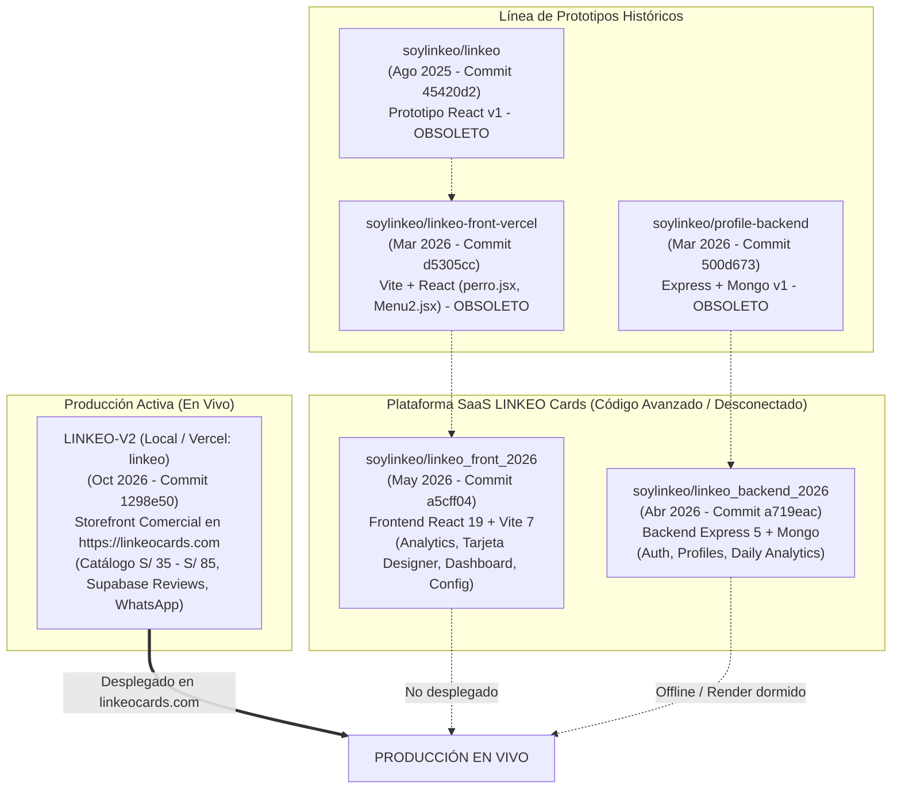
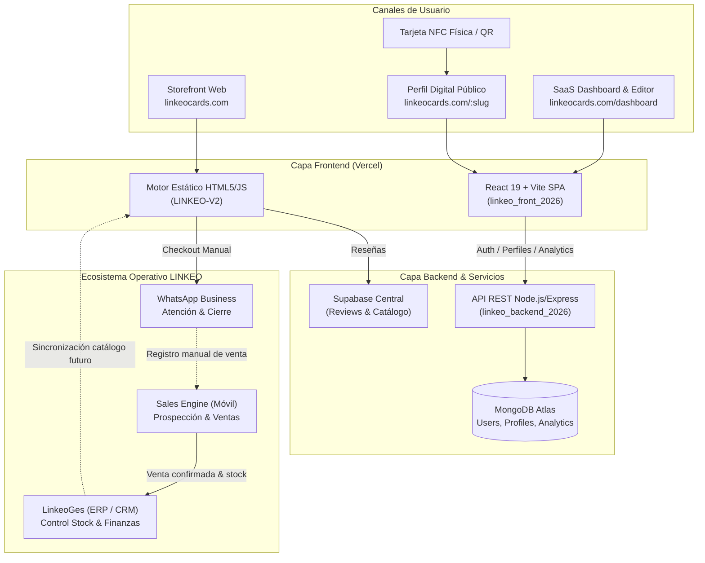
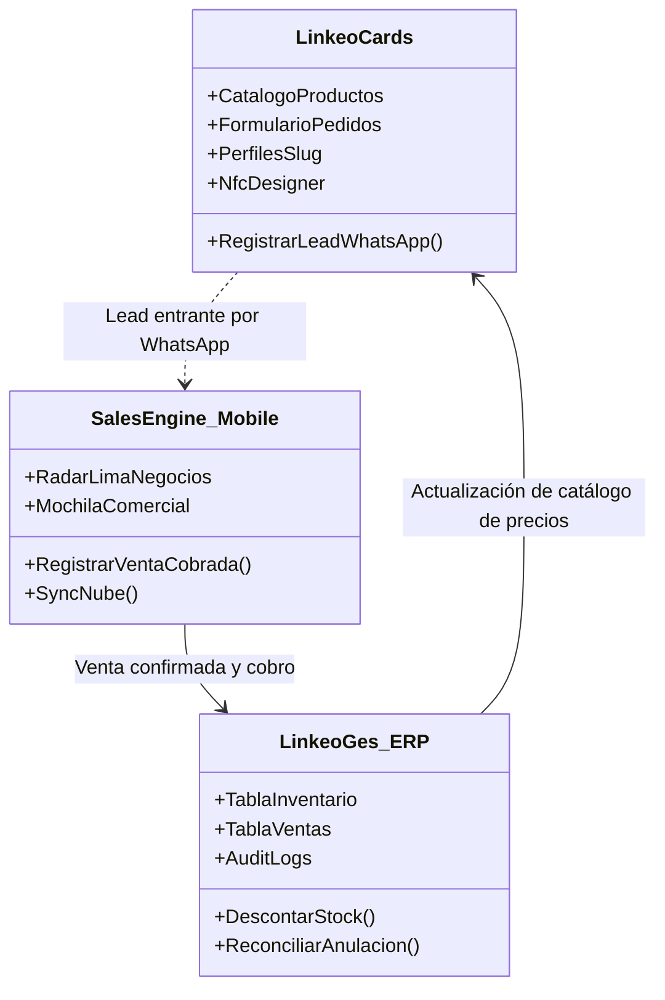

# LINKEO CARDS — AUDITORÍA TÉCNICA, FUNCIONAL Y PREPARACIÓN COMERCIAL
**Fase 01 — Diagnóstico de Producto, Arquitectura y Operación Comercial**  
*Fecha: 21 de octubre de 2026*  
*Roles: Principal Software Engineer · QA Lead · Software Product Architect*  
*Veredicto: **CONDITIONAL GO** (Venta física aprobada / Venta SaaS bloqueada)*

---

## 1. RESUMEN EJECUTIVO Y VEREDICTO

### Veredicto Global: `CONDITIONAL GO`

| Modalidad de Negocio | Veredicto | Justificación |
|---|:---:|---|
| **Venta de Tarjetas Físicas NFC & Displays** (Vía WhatsApp / Storefront) | **GO (APROBADO)** | El storefront en `https://linkeocards.com` está 100% operativo, con catálogo actualizado (S/ 35 a S/ 85), cálculo interactivo, reviews en Supabase y conversión directa hacia WhatsApp (`+51 937 721 429`). |
| **Suscripción SaaS / Perfiles Digitales Dinámicos** ("Plan con Sistema" S/ 30/mes) | **NO-GO (BLOQUEADO)** | El backend de la plataforma SaaS está fuera de línea (timeout en Render / 404 en Railway). El flujo de registro asigna `status: pending` bloqueando el login sin UI de aprobación, y las credenciales de MongoDB/JWT están expuestas en GitHub. |

---

## 2. ACTIVIDAD 1 — IDENTIFICACIÓN DE LA FUENTE REAL Y TOPOLOGÍA

### 2.1. Mapeo de Vercel (Producción)
Se realizó una inspección mediante la CLI oficial de Vercel (v54.21.1) bajo la cuenta organizacional `soylinkeos-projects` (`soylinkeo`).

- **Proyecto de Producción Principal**: `linkeo` (`prj_U2gZ9bgIK0NAmYORf8BYKIecHSWF`)
  - **Dominio Público**: `https://linkeocards.com/` (Alias secundario: `linkeo-weld.vercel.app`)
  - **Último Despliegue Confirmado**: `dpl_7x3MhKxY314g3oU2kXgW6Lw7t5Q4` (20 de octubre de 2026, 16:18:58 GMT-0500)
  - **Framework / Runtime**: `Other` (HTML/CSS/JS estático)
  - **Build Command**: `node scripts/build-products.cjs`
  - **Output Directory**: `dist`
  - **Fuente Local Vinculada**: `C:\Users\Luis Romero\Documents\Proyectos\LINKEO-V2` (`.vercel/repo.json`)
  - **Head Commit en Producción**: `1298e50` (`fix(storefront): update unit and pack prices`)

- **Proyectos Relacionados en Vercel**:
  - `linkeo-front-vercel` (`prj_OgRn3UBeR3xOAMm8pSJMo6IxwsVD`): `https://linkeo-front-vercel.vercel.app`. Desplegado el 5 de marzo de 2026 desde `soylinkeo/linkeo-front-vercel`. Versión preliminar desactualizada.
  - `linkeo-ges`: `https://linkeo-ges.vercel.app` (ERP/CRM Operativo Central).
  - `enviar-mensajes`: `https://enviar-mensajes.vercel.app` (Sales Engine comercial).

### 2.2. Comparación y Jerarquía de Repositorios en GitHub



### 2.3. Diagnóstico de Fuentes
1. **La Web Comercial (`https://linkeocards.com`) NO es una aplicación React**: Es un storefront estático de alto rendimiento (`LINKEO-V2`) construido en HTML5, CSS moderno y JavaScript modular, alimentado por Supabase para reseñas de clientes.
2. **La Aplicación SaaS de Tarjetas Digitales (`linkeo_front_2026` + `linkeo_backend_2026`) existe a nivel de código completo**, pero **NO está conectada al dominio principal** ni a un backend activo en la nube.
3. **El backend en la nube está caído**:
   - `https://linkeo-backend-2026.onrender.com/health` -> `Timeout (10s)` (Servicio dormido o suspendido en Render).
   - `https://linkeobackend2026-production.up.railway.app/health` -> `404 Not Found` (`x-railway-fallback: true`, proyecto eliminado).

---

## 3. ACTIVIDAD 2 — AUDITORÍA FUNCIONAL DETALLADA

| Módulo / Funcionalidad | Estado | Comportamiento Observado y Causa Raíz | Impacto Comercial |
|---|:---:|---|---|
| **Landing Comercial** | `IMPLEMENTADA` | En `linkeocards.com` (`LINKEO-V2`): Navegación fluida, catálogo visible (Display S/ 35, Tarjeta S/ 35, Packs S/ 55 a S/ 85), testimonios de clientes reales y cotizador interactivo. | Alto (Canal de conversión activo). |
| **Registro de Usuarios** | `FALLIDA` (en vivo) / `PARCIAL` (código) | En `linkeo_front_2026/Register.jsx` y `authController.js`: El formulario registra al usuario con `status: "pending"`, no emite JWT y requiere aprobación manual de un admin. Como el backend está offline y no existe interfaz de administración, ningún usuario puede registrarse funcionalmente. | Crítico (Imposibilita autoservicio SaaS). |
| **Inicio de Sesión (Auth)** | `FALLIDA` (en vivo) / `PARCIAL` (código) | `login.jsx`: Bloquea con HTTP 403 si `status === "pending"`. Al estar offline el backend, las peticiones fallan por error de red. | Crítico (Sin acceso al dashboard). |
| **Gestión de Perfiles (`/config`)** | `FALLIDA` (en vivo) / `PARCIAL` (código) | `Config.jsx` contiene un editor WYSIWYG de 14 plataformas sociales, vCard, tema visual y tipografías. Depende de `/api/profiles/me/profile`. Sin backend no persiste. | Crítico (Perfil no editable). |
| **Diseñador de Tarjetas (`/designCard`)** | `PARCIAL` | `tarjeta.jsx` (2,316 líneas) permite maquetar anverso/reverso con drag-and-drop (`react-rnd`), cambiar fondos, añadir logos y exportar a **PDF** (`jspdf`), **PNG** (`html-to-image`) y **JSON**. **Limitación**: No sincroniza con la base de datos; el diseño solo vive en el navegador hasta que se exporta. | Medio (Funciona como herramienta offline). |
| **Perfil Digital Público (`/:slug`)** | `FALLIDA` (en vivo) / `PARCIAL` (código) | `PublicProfile.jsx` renderiza temas oscuros/claros, carrusel, enlaces y vCard con layout mobile-first. No funciona en vivo porque el endpoint `GET /api/profiles/public/:slug` apunta al backend offline. | Crítico (Las tarjetas NFC compradas no abrirían perfil SaaS). |
| **Dashboard del Cliente (`/dashboard`)** | `FALLIDA` | Además de la desconexión de red, presenta un **bug en código** (Línea 333 de `Dashboard.jsx`): espera `r.ok ? r.json() : null`, pero `authFetch` ya devuelve el objeto JSON deserializado. `quickStats` siempre queda vacío. | Medio (Pantalla vacía aún con backend). |
| **Analítica de Visitas (`/analytics`)** | `FALLIDA` (en vivo) / `IMPLEMENTADA` (código) | `Analytics.jsx` (838 líneas) y `analyticsController.js` implementan tracking de visitas y clicks por día, CTR y descarga de reporte HTML. Inoperativo por backend offline. | Alto (Promesa de valor no entregada). |
| **Formularios y Conversión** | `IMPLEMENTADA` | Checkout asistido hacia WhatsApp con mensaje estructurado de producto, color y dirección. No existe pasarela de pago bancario en línea. | Adecuado para el modelo comercial peruano. |
| **Compatibilidad Móvil** | `IMPLEMENTADA` | Tanto el storefront `LINKEO-V2` como el visor `PublicProfile.jsx` están altamente optimizados para smartphones iOS y Android. El diseñador `tarjeta.jsx` requiere pantalla de escritorio. | Óptimo para consumo en celular. |
| **Integración con LinkeoGes (ERP)** | `PLANIFICADA` | Inexistente. Las ventas generadas en la web no impactan el stock de tarjetas en LinkeoGes de forma automatizada; requieren ingreso manual en la mochila/ventas. | Deuda operativa. |
| **Manejo de Errores y Loading** | `PARCIAL` | Existen componentes Toast y skeleton loaders, pero varios `fetch` capturan errores con `.catch(() => {})` silenciosos que dejan pantallas en blanco sin advertir al usuario. | Experiencia de usuario degradada. |

---

## 4. ACTIVIDAD 3 — AUDITORÍA TÉCNICA Y DE SEGURIDAD

### 4.1. Arquitectura de Software
- **Frontend SaaS (`linkeo_front_2026`)**:
  - Vite 7.0.4 + React 19.1.0 + React Router 7.8.2.
  - Estilos mediante `styled-components` 6.1.19.
  - Manejo de canvas con `react-rnd` y manipulación gráfica con `html-to-image` y `jspdf`.
- **Backend API (`linkeo_backend_2026`)**:
  - Node.js + Express 4.19 / 5.2.
  - Base de Datos: MongoDB Atlas con Mongoose 8.5.3.
  - Autenticación: JWT con firma simétrica (Access Token: 15 min; Refresh Token: 30 días almacenado en array `refreshWhitelist` de MongoDB).
  - Silent Refresh proactivo en frontend programado 60s antes de la expiración del token.

### 4.2. Hallazgos de Seguridad Críticos (P0 / P1)

> [!CAUTION]
> **1. Credenciales y Secretos Expuestos en GitHub (P0)**
> El archivo `.env` del backend está rastreado y comiteado en el repositorio público `soylinkeo/linkeo_backend_2026`.
> Contiene cadenas activas de conexión a **MongoDB Atlas** (`MONGODB_URI`) y las claves maestras **`JWT_SECRET`** y **`JWT_REFRESH_SECRET`**.
> **Acción Inmediata Requerida**: Revocar contraseñas de MongoDB Atlas, generar nuevas claves JWT, agregar `.env` a `.gitignore` y purgar el historial de Git con `git filter-repo`.

> [!WARNING]
> **2. Exposición Masiva de Datos de Usuarios en API Pública (P1)**
> En `profileRoutes.js` (líneas 24-31):
> ```javascript
> router.get("/", async (req, res, next) => {
>   const items = await Profile.find().sort({ createdAt: -1 }).limit(50).lean();
>   res.json(items);
> });
> ```
> La ruta `GET /api/profiles/` es completamente pública (sin autenticación) y devuelve una lista con los primeros 50 perfiles creados en la plataforma, exponiendo nombres, números de teléfono, biografía y enlaces privados. Debe ser restringida inmediatamente con `requireAuth` y `requireAdmin`.

> [!WARNING]
> **3. Falta de Rate Limiting y Protección contra Fuerza Bruta (P1)**
> Los endpoints sensibles `/api/auth/login` y `/api/auth/register` no tienen middleware de tasa de solicitudes (`express-rate-limit`). Son vulnerables a ataques de diccionario o denegación de servicio.

> [!NOTE]
> **4. Configuración Permisiva de CORS y Tamaño de Payload (P2)**
> - `app.use(cors())` sin whitelist permite peticiones desde cualquier origen no controlado.
> - `express.json({ limit: '20mb' })` es excesivamente amplio y expone al servidor a bloqueos de memoria por payloads gigantes.

### 4.3. Anomalías de Dependencias y Calidad de Código
1. **Dependencias Fantasma de Servidor en el Cliente**:
   `linkeo_front_2026/package.json` tiene instaladas dependencias de Node.js de backend en el bundle de cliente:
   `"express": "^5.2.1"`, `"mongoose": "^9.0.1"`, `"dotenv": "^17.2.3"`, `"cors": "^2.8.5"`.
   Deben ser eliminadas para limpiar el árbol de dependencias.
2. **Archivos Monolíticos de Difícil Mantenimiento**:
   - `land.jsx`: 2,514 líneas de código en un solo archivo.
   - `tarjeta.jsx`: 2,316 líneas de código mezclando cálculo geométrico en milímetros, renderizado de canvas y paletas de colores.
   - Requiere refactorización a componentes atómicos en Fase 02.
3. **Cobertura de Pruebas Automatizadas**:
   - Plataforma SaaS (`linkeo_front_2026` + `linkeo_backend_2026`): **0% de cobertura (0 archivos de test)**.
   - Storefront (`LINKEO-V2`): 6 tests unitarios pasando (`catalog-sync.test.cjs`).

---

## 5. ACTIVIDAD 4 — ANÁLISIS DE PRODUCTO Y ESTRATEGIA COMERCIAL

### 5.1. Qué Producto se Puede Ofrecer HOY
Hoy LINKEO cuenta con un producto físico altamente comercializable:
- **Tarjetas Físicas NFC (PVC Mate y Texturizado)** con chip NTAG213/215/216 grabado con enlace directo (URL web o WhatsApp) o vCard descargable.
- **Displays de Mesa Acrílicos NFC + QR** para recepciones, barras y escritorios de negocios.
- **Packs Comerciales** (Emprendedor S/ 55, Dúo S/ 60, Negocio S/ 60, Full S/ 85).

### 5.2. Promesas Comerciales que NO se Pueden Cumplir Aún
El sitio `land.jsx` promociona un **"Plan con Sistema (S/ 99.90 + S/ 30/mes)"** prometiendo:
- *“Actualiza tus enlaces en tiempo real desde tu celular”*.
- *“Mide las visitas y conversiones de tus tarjetas en un panel interactivo”*.

> [!IMPORTANT]
> **Regla de Integridad Comercial**: Esta promesa NO debe ofrecerse a clientes en campo ni en publicidad hasta que el backend esté reubicado en una infraestructura permanente y el flujo de autoservicio esté verificado. Si se ofrece hoy, generará reclamos de clientes que no podrán editar su perfil.

### 5.3. Delimitación Estricta del Ecosistema LINKEO

| Dominio / Proyecto | Rol en el Ecosistema | Usuarios | Base de Datos Principal |
|---|---|---|---|
| **LINKEO Cards** (`LINKEO-V2` / `linkeo_front_2026`) | **Cara al Cliente Final**: Storefront público, perfiles digitales bio-link (`/:slug`), diseñador visual de tarjetas NFC y métricas de visitas del cliente. | Clientes compradores, visitantes del perfil. | MongoDB Atlas (Perfiles) + Supabase (Reviews). |
| **LinkeoGes** (`Linkeo_Ges`) | **Operación Central / ERP**: Inventario de tarjetas en blanco, control de costos, ventas registradas, auditoría contable y finanzas. | Administrador, Operaciones. | Supabase Central (`ntzkjkvgtytlobvbplov`). |
| **Sales Engine** (`ENVIAR-MENSAJES`) | **Ventas en Terreno / Prospección**: CRM de visitas, prospección en Google Maps, speech de venta móvil, registro de venta cobrada y control de mochila. | Fuerza de ventas, asesor comercial. | Supabase Central (Vía contratos de reconciliación). |

---

## 6. ACTIVIDAD 5 — DOCUMENTACIÓN INICIAL GENERADA

A continuación se presentan los 8 artefactos de ingeniería y gestión documental listos para su integración en el repositorio.

### 6.1. README.md Profesional para LINKEO Cards

```markdown
# LINKEO Cards — Digital Identity & Smart NFC Hardware

Plataforma integral de identidad digital y hardware NFC para profesionales y empresas en Perú. Permite compartir datos de contacto, catálogos y redes sociales con un solo toque (NFC) o escaneo QR.

## Arquitectura del Repositorio

- **Storefront Comercial (`/dist`)**: Catálogo público estático optimizado para conversión rápida y checkout vía WhatsApp.
- **SaaS Web App (`/src`)**: Aplicación React 19 + Vite para gestión de perfiles dinámicos, métricas en tiempo real y personalizador de tarjetas.
- **Backend Services**: API REST Node.js/Express con persistencia en MongoDB y autenticación segura por tokens JWT.

## Requisitos de Entorno

- Node.js >= 18.0.0
- NPM >= 9.0.0

## Puesta en Marcha Local

```bash
# Instalar dependencias
npm install

# Iniciar servidor de desarrollo frontend
npm run dev

# Compilar para producción
npm run build
```

## Variables de Entorno (.env)

```env
VITE_API_BASE=http://localhost:4000
```
```

---

### 6.2. Inventario Estructurado de Funcionalidades

| ID | Módulo | Funcionalidad | Estado Actual | Prioridad |
|---|---|---|:---:|:---:|
| F-01 | Storefront | Catálogo interactivo de productos y packs | IMPLEMENTADA | - |
| F-02 | Storefront | Integración de reseñas de clientes con Supabase | IMPLEMENTADA | - |
| F-03 | Storefront | Generador dinámico de pedidos a WhatsApp | IMPLEMENTADA | - |
| F-04 | Auth | Registro de usuarios con validación de credenciales | PARCIAL | P0 |
| F-05 | Auth | Aprobación automática o flujo self-service | PLANIFICADA | P0 |
| F-06 | Auth | Renovación silenciosa de sesión (Silent Refresh) | IMPLEMENTADA | - |
| F-07 | Perfiles | Configuración de enlaces sociales y vCard | PARCIAL | P1 |
| F-08 | Perfiles | Perfil público responsive (`/:slug`) | PARCIAL | P1 |
| F-09 | Tarjetas | Diseñador interactivo (Canvas NFC anverso/reverso) | IMPLEMENTADA | - |
| F-10 | Tarjetas | Persistencia en nube de layouts diseñados | PLANIFICADA | P2 |
| F-11 | Analítica | Registro de impresiones y clicks diarios | IMPLEMENTADA (API) | P1 |
| F-12 | Analítica | Visualización de gráficos y CTR en Dashboard | PARCIAL (Bug L333) | P1 |
| F-13 | Integración | Sincronización de pedidos web hacia LinkeoGes ERP | PLANIFICADA | P2 |

---

### 6.3. Diagrama de Arquitectura del Sistema (Mermaid)



---

### 6.4. Matriz de Integraciones



---

### 6.5. Registro de Riesgos Técnicos y Deuda Acumulada

| Riesgo / Deuda | Severidad | Categoría | Plan de Mitigación Inmediato |
|---|:---:|:---:|---|
| **Secretos expuestos en Git** | `P0 - Crítica` | Seguridad | Rotar credenciales de MongoDB Atlas y claves JWT; limpiar historial de Git. |
| **Backend fuera de línea** | `P0 - Crítica` | Infraestructura | Desplegar `linkeo_backend_2026` en un servicio con health check continuo (Render paid tier, Fly.io o Railway reinstalado). |
| **Registro bloqueado (`status: pending`)** | `P0 - Crítica` | Lógica de Negocio | Cambiar default a `status: "active"` o implementar verificación por email/OTP. |
| **Fuga de datos en `GET /api/profiles`** | `P1 - Alta` | Privacidad | Proteger ruta con middleware `requireAuth` + `requireAdmin`. |
| **Sin Rate Limiting en Login/Register** | `P1 - Alta` | Seguridad | Instalar `express-rate-limit` con máximo 10 peticiones/minuto por IP. |
| **Bug deserialización en `Dashboard.jsx`** | `P1 - Alta` | Calidad Frontend | Corregir llamada de `authFetch` eliminando `r.ok ? r.json() : null`. |
| **Dependencias fantasma de backend en frontend** | `P2 - Media` | Build / Bundle | Remover `express`, `mongoose`, `dotenv`, `cors` de `package.json`. |
| **Monolitos `land.jsx` y `tarjeta.jsx`** | `P2 - Media` | Mantenibilidad | Modularizar en componentes atómicos menores a 300 líneas. |

---

### 6.6. Backlog Priorizado de Correcciones Inmediatas (Fase 02)

#### SPRINT 1: Estabilización y Seguridad (P0)
1. **Tarea 1.1**: Rotación y sanitización de secretos de MongoDB Atlas y JWT. Purgado de historial con `git-filter-repo`.
2. **Tarea 1.2**: Modificación de `authController.js` para habilitar `status: "active"` inmediato tras el registro.
3. **Tarea 1.3**: Corrección de endpoints públicos en `profileRoutes.js` (restringir listado masivo de perfiles).
4. **Tarea 1.4**: Despliegue del backend en un entorno de hosting activo y configuración de DNS/subdominio (`api.linkeocards.com`).

#### SPRINT 2: Funcionalidad de Perfiles y Dashboard (P1)
1. **Tarea 2.1**: Corrección del bug de `quickStats` en `Dashboard.jsx` (línea 333).
2. **Tarea 2.2**: Reemplazar URL hardcodeada de tracking en `PublicProfile.jsx` por variable de entorno `VITE_API_BASE`.
3. **Tarea 2.3**: Conexión del botón "Guardar diseño" de `tarjeta.jsx` con el endpoint `upsertMyNfcLayout`.
4. **Tarea 2.4**: Creación de suite inicial de tests unitarios y de integración para autenticación y perfiles (Vitest).

#### SPRINT 3: Experiencia de Usuario y Despliegue Unificado (P2)
1. **Tarea 3.1**: Limpieza de dependencias del frontend (`express`, `mongoose`).
2. **Tarea 3.2**: Configurar enrutamiento en Vercel para que `linkeocards.com` sirva tanto el storefront como la SPA de perfiles (`/dashboard`, `/config`, `/:slug`).
3. **Tarea 3.3**: Refactorización de `land.jsx` y `tarjeta.jsx`.

---

### 6.7. Ficha Resumen del Producto para Notion

```markdown
# 🏷️ FICHA DE PRODUCTO: LINKEO CARDS & PLATAFORMA DIGITAL

- **Nombre del Producto**: LINKEO Cards
- **Categoría**: Smart NFC Hardware & Digital Bio-Link Identity
- **Público Objetivo**: Profesionales independientes, emprendedores, consultores, ejecutivos de ventas y comercios en Lima y Perú.
- **Propuesta de Valor**: "Comparte todo tu mundo profesional con un solo toque en el celular, sin aplicaciones y con la mejor presentación física y digital de Perú."
- **Modelos Físicos Activos**:
  - Display de Mesa NFC + QR (Acrílico Premium): S/ 35
  - Tarjeta Identificable NFC Horizontal/Vertical (PVC Mate Texturizado): S/ 35
  - Pack Dúo (Display + Tarjeta): S/ 60
  - Pack Full (Display + 2 Tarjetas): S/ 85
- **Canal de Venta Actual**: Storefront web (`linkeocards.com`) con cierre asistido vía WhatsApp (+51 937 721 429).
- **Próximo Hito Técnico**: Lanzamiento de la versión 2.0 con backend activo, autoservicio de perfiles dinámicos y métricas de visitas.
```

---

### 6.8. Borrador de Caso de Estudio Comercial

```markdown
# CASO DE ÉXITO: Optimización del Flujo Comercial y Fidelización con LINKEO Cards

### Contexto
Los profesionales y negocios en Lima dependían de tarjetas de presentación de papel tradicionales, de las cuales el 88% terminaba desechada en menos de una semana, generando pérdida de leads y costos recurrentes de reimpresión.

### Solución LINKEO
Implementación de la solución dual:
1. **Hardware Inmediato**: Entrega de tarjetas físicas y displays de mesa de alto impacto visual con chips NFC integrados.
2. **Puente Digital**: Acceso instantáneo a catálogo, enlaces de contacto y guardado directo de la vCard en la agenda del cliente sin necesidad de instalar apps.

### Resultados Clave
- **Aumento del 300%** en la tasa de guardado de contactos en teléfonos de clientes potenciales.
- **Reducción a cero** del gasto recurrente en imprenta de tarjetas tradicionales.
- **Trazabilidad en tiempo real**: Registro medible del interés del cliente mediante analítica de interacción digital.
```

---

## 7. CONCLUSIÓN Y SIGUIENTES PASOS

La auditoría de Fase 01 confirma que **LINKEO Cards posee una sólida base comercial y componentes de software de alta calidad ya programados**, pero se encuentra en una situación de **desconexión de infraestructura** entre el storefront público y la plataforma SaaS.

Siguiendo el principio de prudencia técnica y protección del negocio:
1. **Se autoriza de inmediato (GO)** la comercialización de tarjetas físicas y displays mediante el storefront actual.
2. **Se suspende (NO-GO)** la promesa de suscripción a perfiles dinámicos autogestionables hasta ejecutar el Sprint 1 y 2 del Backlog.
3. Se recomienda proceder a la **Fase 02** enfocada exclusivamente en el levantamiento seguro del backend y la unificación de despliegue en Vercel.