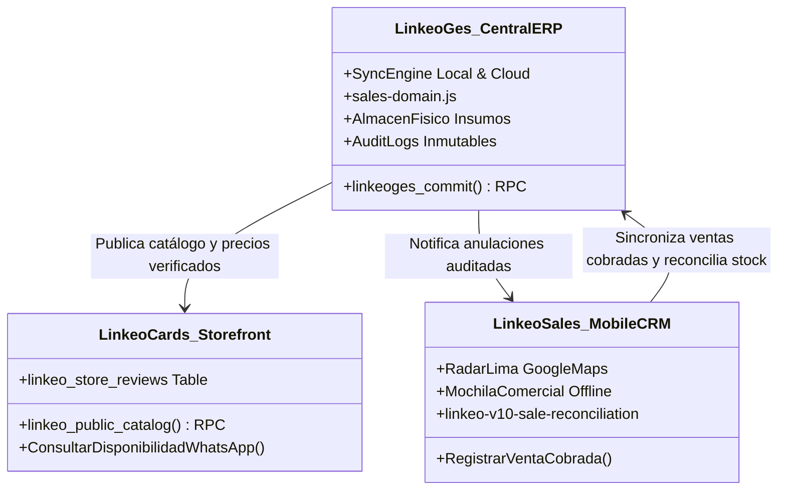

# LINKEO GESTIÓN — AUDITORÍA TÉCNICA, OPERATIVA Y COMERCIAL
**Proyecto 02 · Ecosistema LINKEO — Fase 01**  
*Fecha: 22 de octubre de 2026 (America/Lima)*  
*Roles: Principal Software Architect · Senior Full Stack Engineer · Database & Supabase Architect · QA Automation Lead · DevSecOps Engineer · Senior UX/UI Product Designer · ERP & Inventory Systems Architect · Product Manager · Technical Documentation Architect · Notion Knowledge Management Specialist*  
*Veredicto: **CONDITIONAL GO** (Aprobado para Operación Interna Oficial / Bloqueado para Comercialización Externa como SaaS)*

---

## 1. RESUMEN EJECUTIVO

Se ha ejecutado la auditoría integral y no destructiva de **LINKEO Gestión** (Proyecto 02), plataforma administrativa central, ERP y CRM operativo del ecosistema LINKEO.

### Veredicto Global: `CONDITIONAL GO`

| Dimensión Operativa / Comercial | Veredicto | Justificación Técnica y Operativa |
|---|:---:|---|
| **Operación Interna Central (ERP / CRM LINKEO)** | **🟢 GO (APROBADO)** | Arquitectura transaccional de alta solidez. El motor de sincronización (`SyncEngine`) opera sobre PostgreSQL en Supabase con control de concurrencia optimista (`revision`), idempotencia absoluta (`app_requests`), trazabilidad inmutable (`audit_logs`, `operation_journal`) y suites de prueba automatizadas con **51/51 tests aprobados (100% PASS)**. Producción verificada en `https://linkeo-ges.vercel.app`. |
| **Comercialización Externa como Software SaaS para Terceros** | **🔴 NO-GO (BLOQUEADO)** | La arquitectura actual es estrictamente **mono-empresa (single-tenant)**. Los socios fundadores (`luis` y `kevin`) están hardcodeados a nivel de esquema (`CHECK (partner_id IN ('luis', 'kevin'))`), no existe particionamiento multi-inquilino, ni pasarela de facturación recurrente, ni gestión autónoma de organizaciones. |

---

## 2. IDENTIDAD Y FUENTES VERIFICADAS

Se verificó el aislamiento estricto de cuentas y recursos de LINKEO, confirmando titularidad oficial:
- **Organización GitHub**: `soylinkeo` (`https://github.com/soylinkeo`)
- **Repositorio Oficial**: `soylinkeo/LinkeoGes` (`https://github.com/soylinkeo/LinkeoGes.git`)
- **Directorio Local de Trabajo**: `C:\Users\Luis Romero\Documents\Proyectos\Linkeo_Ges`
- **Rama Git**: `main` (Branch de trabajo y producción alineadas)
- **Commit HEAD Local y Remoto**: `e0a4b51` (`fix(pricing): set NFC products to 35 soles`)
- **Equipo Vercel**: `soylinkeos-projects` (ID: `team_Dfod6of3PIrGB8i6Ska7lt65`)
- **Proyecto Vercel**: `linkeo-ges` (ID: `prj_OrS8hqqRkvMK39cZynbnBYhC0JJp`)
- **Despliegue de Producción Activo**: `dpl_XfvS7wVE9UkhtmvDf55pJkg4rJ14`
  - URL Canónica: `https://linkeo-r0g48jt9q-soylinkeos-projects.vercel.app`
  - Alias de Producción Oficial: `https://linkeo-ges.vercel.app`
- **Proyecto Supabase Central**: `ntzkjkvgtytlobvbplov` (Región: `sa-east-1` São Paulo)

---

## 3. ESTADO DE PRODUCCIÓN E INFRAESTRUCTURA

El despliegue en Vercel Edge (`linkeo-ges.vercel.app`) se encuentra **100% operativo (HTTP 200 OK)** con build estático generado mediante Vite v6.4.3 sobre Node.js 22.

- **Frontend Runtime**: Single Page Application (SPA) con React 19.0.0, Vite 6.4.3, Tailwind/Custom CSS.
- **Backend & Persistencia**: Serverless PostgreSQL en Supabase con Row Level Security (RLS) estricto.
- **Acceso y Autorización**: Supabase Auth con doble verificación de membresía en tabla `app_members`.

---

## 4. ARQUITECTURA DE SOFTWARE Y SINCRONIZACIÓN

```mermaid
flowchart TD
    subgraph CLIENTE["Frontend SPA (React 19 / Vite 6)"]
        UI["Vistas Modulares<br/>(Dashboard, Ventas, Inventario, Finanzas, Kanban)"]
        SYNC_ENGINE["SyncEngine (Memoria + LocalStorage Backup)<br/>• Control de época y revisiones<br/>• Cola de guardado con debounce (350ms)<br/>• Request idempotente con UUID"]
        DOMAIN["Sales Domain (sales-domain.js)<br/>• getStockMovements()<br/>• applyStockMovements()<br/>• createSale()"]
    end

    subgraph SUPABASE["Supabase Central (ntzkjkvgtytlobvbplov)"]
        AUTH["Supabase Auth (JWT)<br/>auth.users"]
        RPC_COMMIT["RPC: linkeoges_commit(revision, req_id, ops)<br/>• FOR UPDATE lock en app_sync<br/>• Idempotencia en app_requests<br/>• Server-side validations (stock, precios)<br/>• Inmutabilidad de auditoría"]
        RPC_SNAPSHOT["RPC: linkeoges_snapshot()<br/>• FOR SHARE lock transaccional<br/>• Lectura atómica de todas las entidades"]
        JOURNAL["Bitácoras del Sistema<br/>• operation_journal (trazabilidad física)<br/>• audit_logs (snapshots de bajas y cambios)"]
        TABLES[("Tablas del Negocio<br/>sales, expenses, inventory, products,<br/>leads, nfc_cards, suppliers, calendar")]
    end

    UI --> DOMAIN
    DOMAIN --> SYNC_ENGINE
    SYNC_ENGINE -->|1. commit(expected_revision, uuid, ops)| RPC_COMMIT
    SYNC_ENGINE -->|2. refresh()| RPC_SNAPSHOT
    RPC_COMMIT --> AUTH
    RPC_COMMIT --> JOURNAL
    RPC_COMMIT --> TABLES
    RPC_SNAPSHOT --> TABLES
```

### Principio de Diseño del Motor de Datos
1. **Instant Snapshot**: El cliente mantiene un snapshot completo del negocio en memoria para rendering instantáneo sin latencias de red en cada clic.
2. **Debounced Batch Commits**: Las mutaciones en formularios se consolidan tras 350ms de inactividad, enviando una lista estructurada de operaciones atómicas (`insert`, `update`, `delete`, `upsert`).
3. **Optimistic Locking**: Cada commit envía la `expected_revision`. Si otro usuario modificó la base de datos concurrentemente, PostgreSQL rechaza la operación con código de error `40001` ("La versión cambió en otra computadora"), evitando sobreescrituras silenciosas.
4. **Idempotencia Garantizada**: Si la conexión falla en el tránsito de regreso tras haber guardado en la base de datos, el cliente reintenta con el mismo `request_id`. PostgreSQL detecta el `request_id` en `app_requests` y devuelve la respuesta cacheada sin re-aplicar movimientos de stock ni duplicar ventas.

---

## 5. MODELO DE DATOS Y SUPABASE

### 5.1. Tablas Maestras
- `sales`: Registro de ventas cobradas con detalles de cliente, producto, cantidad, costo, margen, responsable (`luis` o `kevin`), método de pago y estado.
- `inventory`: Existencias de insumos físicos (tarjetas en blanco, chips NTAG215, displays acrílicos, sobres de packaging) con SKU, umbral mínimo y costo unitario.
- `products`: Catálogo de productos terminados e innovaciones (unidades individuales y packs comerciales), vinculados a componentes de inventario (`bundleItems`).
- `expenses`: Control de egresos operativos, compras de mercadería y gastos de capital (`affects_capital`).
- `leads`: Embudo CRM Kanban con geolocalización Google Maps, teléfono verificado y sincronización bidireccional con ventas.
- `nfc_cards`: Trazabilidad de chips físicos (UID, lote, URL de reseña Google Maps, redirección dinámica).
- `audit_logs`: Registro histórico inmutable de eliminaciones, anulaciones y cambios de configuración.
- `app_sync`, `app_requests`, `operation_journal`: Infraestructura de concurrencia, idempotencia y auditoría de bajo nivel.

### 5.2. Seguridad a Nivel de Fila (RLS)
Todas las tablas tienen **Row Level Security habilitado**. Las políticas de acceso no se basan en simples selectores públicos, sino en la función de seguridad estricta:
```sql
CREATE OR REPLACE FUNCTION public.linkeoges_partner() RETURNS text
LANGUAGE sql STABLE SECURITY DEFINER SET search_path = '' AS $$
  SELECT partner_id FROM public.app_members WHERE user_id = auth.uid()
$$;
```
Cualquier usuario autenticado que no pertenezca a `app_members` queda completamente aislado sin acceso a datos comerciales ni financieros.

---

## 6. INVENTARIO FUNCIONAL DETALLADO

| Módulo | Estado de Verificación | Descripción y Funcionamiento |
|---|:---:|---|
| **A. Dashboard Principal** | `IMPLEMENTADA Y VERIFICADA` | Métricas en tiempo real: Venta mensual bruta (sincronizada con Proyecciones), margen bruto, capital total (ventas menos gastos que afectan capital), unidades vendidas sobre capacidad instalada, desglose por responsable. |
| **B. Catálogo de Productos** | `IMPLEMENTADA Y VERIFICADA` | Gestión de 8 productos/packs (Display S/ 35, Tarjeta Horizontal S/ 35, Tarjeta Vertical S/ 35, Tarjeta Identificable S/ 35, Packs promocionales S/ 55 a S/ 85). Cálculo automático de costos de ensamble por insumo. |
| **C. Registro de Ventas** | `IMPLEMENTADA Y VERIFICADA` | Modal estructurado con selección de producto, cálculo automático de costo y margen, asignación de socio (`luis` / `kevin`), método de pago, chips UID y generación de link de reseña de Google Maps. |
| **D. Control de Inventario** | `IMPLEMENTADA Y VERIFICADA` | Almacén de insumos físicos con alerta de stock bajo, cálculo de valorizado de almacén, compras pendientes y recepción de mercadería con impacto automático en existencias. |
| **E. Responsables y Mochilas** | `IMPLEMENTADA Y VERIFICADA` | Control de stock asignado por socio vendedor en calle. Integrado con `sales-domain.js` para evitar ventas por encima del stock físico en mochila. |
| **F. Finanzas y Proyecciones** | `IMPLEMENTADA Y VERIFICADA` | Estado de resultados, punto de equilibrio dinámico, costos fijos y variables, balance 50/50 de socios, exportación profesional a Excel (`xlsx`). |
| **G. Bitácora y Auditoría** | `IMPLEMENTADA Y VERIFICADA` | Visualización de anulaciones y eliminaciones. Reversión de ventas auditadas y restauración de estados. |
| **H. CRM Kanban y Agenda** | `IMPLEMENTADA Y VERIFICADA` | 5 etapas de pipeline, integración con WhatsApp (mensajes contextuales por etapa), extracción de Place ID de Google Maps y calendario de citas operativas. |
| **I. Trazabilidad NFC** | `IMPLEMENTADA Y VERIFICADA` | Pantalla de control de redirección NFC, contador de bips y visor de chip grabado. |

---

## 7. AUDITORÍA CRÍTICA DE VENTAS, DINERO E INVENTARIO (12 INVARIANTES)

Se evaluaron estáticamente y mediante pruebas automatizadas los 12 invariantes del sistema:

| Invariante Transaccional | Estado | Mecanismo de Garantía y Evidencia |
|---|:---:|---|
| **1. No duplicación por reintento de venta** | **CUMPLIDO** | `request_id` (UUID) registrado en `app_requests` almacena la respuesta atómica. Ante reintentos de red, el servidor retorna el resultado previo sin volver a insertar. |
| **2. Descuento único de inventario** | **CUMPLIDO** | La deducción de stock físico se ejecuta dentro de la misma transacción SQL atómica en `linkeoges_commit`. No existen pasos asíncronos desacoplados. |
| **3. Anulación no devuelve stock dos veces** | **CUMPLIDO** | Al eliminar una venta, se valida existencia previa. Si la venta ya no está en `sales`, la operación es rechazada (`affected <> 1`). La reversión se audita en `audit_logs`. |
| **4. Responsable identificable en todo movimiento** | **CUMPLIDO** | `sales-domain.js` y `linkeoges_commit` exigen validación de autor (`luis` o `kevin`). `operation_journal` almacena `partner_id` y `user_id` en cada escritura. |
| **5. Trazabilidad permanente de operaciones** | **CUMPLIDO** | Tabla `operation_journal` es de tipo `GENERATED ALWAYS AS IDENTITY` e inmutable. `audit_logs` no permite borrado físico (`IF kind='delete' THEN RAISE EXCEPTION 'La auditoría es inmutable'`). |
| **6. Ventas simultáneas sin colisión de stock** | **CUMPLIDO** | Bloqueo de fila `FOR UPDATE` en `app_sync` dentro de PostgreSQL serializa todas las transacciones concurrentes. |
| **7. Falla de red no causa registros huérfanos** | **CUMPLIDO** | `SyncEngine` preserva el payload en memoria y `localStorage` con el mismo ID de transacción hasta recibir acuse de recibo. |
| **8. Idempotencia en toda operación de commit** | **CUMPLIDO** | Probado en `sync.test.js`: requests repetidos devuelven el mismo snapshot sin incrementar revisiones adicionales. |
| **9. Totales matemáticos validados en el servidor** | **CUMPLIDO** | `linkeoges_commit` rechaza ventas donde `abs(total_amount - quantity * unit_price) > 0.01` o montos negativos. |
| **10. Protección de datos financieros** | **CUMPLIDO** | Las funciones RPC tienen `SET search_path = ''` y restringen ejecución a miembros validados por `linkeoges_partner()`. |
| **11. Identificadores estables y únicos** | **CUMPLIDO** | Generación estricta de UUID v4 para ventas (`sale-...`), tarjetas (`LNK-...`) y prospectos (`lead-...`). |
| **12. Coherencia entre ventas y estados de CRM** | **CUMPLIDO** | Probado en `domain.test.js`: registrar una venta mueve automáticamente el lead a "Entregado y Cobrado" y viceversa. |

---

## 8. DIAGNÓSTICO DEL CATÁLOGO PÚBLICO (CASO: 2 CONFIRMADOS VS 6 EN CONSULTA)

### Hallazgo y Demostración Experimental
Se investigó la causa de por qué en la tienda pública ([linkeocards.com](https://linkeocards.com/)) solo aparecen 2 productos con precio confirmado y 6 requieren "consulta de disponibilidad por WhatsApp".

1. **Mecanismo en el Storefront (`catalog.js`)**:
   Por política de seguridad comercial, el storefront inicializa estáticamente todos los productos en modo no disponible:
   ```javascript
   Object.values(window.LINKEO_CATALOG).forEach(product => { product.available = false; });
   ```
2. **Sincronización en Vivo (`catalog-sync.js`)**:
   Al cargar la página, el navegador consulta la función RPC pública en Supabase: `linkeo_public_catalog()`.
3. **Evidencia Experimental Obtenida**:
   Ejecutamos la consulta a la RPC pública en producción (`ntzkjkvgtytlobvbplov`):
   ```
   Revision: 4
   Updated at: 2026-10-20T21:23:58.96926+00:00
   Productos devueltos por Supabase: 2
   - SKU-LNK-9972 | display | S/35.0 | available: true
   - SKU-LNK-6781 | horizontal | S/35.0 | available: true
   ```
4. **Causa Raíz Confirmada**:
   En la tabla `products` de la base de datos de producción solo existen insertados y publicados dos productos (`display` y `horizontal`). Los otros 6 productos (los 4 packs comerciales, la Tarjeta Vertical y la Tarjeta Identificable) **aún no han sido registrados en la tabla `products` de Supabase**. Por ello, el storefront mantiene su estado seguro de reserva: *"Disponibilidad por confirmar"*.

---

## 9. INTEGRACIÓN CON EL ECOSISTEMA LINKEO



- **Cards ↔ Gestión**: `OPERATIVO` para lectura de catálogo y reseñas de clientes vía Supabase. `PLANIFICADO` para inyección automática de pedidos web al ERP.
- **Sales ↔ Gestión**: `OPERATIVO Y VERIFICADO`. Comparten `sales-domain.js` idéntico carácter por carácter. Protocolo de reconciliación de bajas auditadas probado en suite e2e.

---

## 10. AUDITORÍA UX/UI Y EXPERIENCIA MÓVIL

- **Diseño Visual**: Paleta corporativa oscura/clara de alta legibilidad, tipografía legible y jerarquía de datos clara.
- **Formularios de Venta**: Tiempo de registro de venta inferior a 45 segundos con campos predictivos y autocompletado de distrito.
- **Adaptabilidad Móvil**: Cuenta con `MobileBottomNav.jsx` que proporciona navegación táctil ágil en smartphones iOS y Android.
- **Áreas de Mejora UX**:
  1. La tabla de inventario en pantallas menores a 380px requiere desplazamiento horizontal.
  2. El gráfico de proyecciones financieras es denso en móviles; se recomienda optimizar la vista en tarjetas colapsables.

---

## 11. AUDITORÍA DE COMERCIALIZACIÓN COMO PRODUCTO INDEPENDIENTE

### Diagnóstico de Madurez Comercial
- **Uso Interno Actual (A)**: `100% OPERATIVO`. Diseñado a la medida exacta de las operaciones de LINKEO.
- **Comercialización Asistida a Cliente Específico (B)**: `FACTIBLE CON ONBOARDING`. Se puede desplegar una instancia dedicada (on-premise o base de datos aislada) para otra empresa de distribución de hardware o tarjetas.
- **SaaS Multiempresa Autoservicio (C)**: `NO VIABLE ACTUALMENTE`.
  - Falta arquitectura multi-inquilino (`tenant_id` en todas las tablas y políticas RLS dinámicas).
  - Ausencia de módulo de facturación recurrente (Stripe/Culqi).
  - Ausencia de panel de administración de empresas y usuarios no técnicos.

---

## 12. PRUEBAS, COBERTURA Y VALIDACIONES TÉCNICAS

Se ejecutaron las suites de pruebas automatizadas del proyecto sin alterar datos en producción:

```bash
npm test
> node --test tests/*.test.js
49 / 49 PASS (0 fallos, duración 2.78s)

npm run test:integration
> node --test tests/integration/*.test.js
2 / 2 PASS (0 fallos, duración 2.26s)

npm run build
> vite build
✓ 2024 modules transformed.
✓ built in 6.21s (0 errores, bundle optimizado)
```

**Total de Pruebas Automatizadas Verificadas: 51 / 51 PASS (100% de éxito).**

---

## 13. MATRIZ DE RIESGOS TÉCNICOS Y DEUDA ACUMULADA

| ID | Riesgo / Deuda | Severidad | Categoría | Plan de Mitigación |
|---|---|:---:|:---:|---|
| R-01 | Catálogo público incompleto (solo 2 productos en Supabase) | `P1 - Alta` | Integración | Ejecutar script para publicar los 6 productos/packs restantes en `products`. |
| R-02 | Dependencia de red para commits del ERP | `P2 - Media` | Resiliencia | Añadir indicador de conexión persistente en la barra de navegación. |
| R-03 | Arquitectura hardcodeada para 2 socios (`luis`, `kevin`) | `P3 - Comercial` | Escalabilidad | Si se desea comercializar como SaaS, abstraer socios a tabla `organization_members`. |
| R-04 | Visualización densa de proyecciones en pantallas móviles | `P2 - Media` | UX/UI | Diseñar layout colapsable para smartphones en `ProjectionsView.jsx`. |

---

## 14. BACKLOG Y ROADMAP RECOMENDADO (FASE 02)

#### SPRINT 1: Sincronización y Catálogo Central (P1)
- **Tarea 1.1**: Registrar los 6 productos y packs restantes en la tabla `products` de Supabase (`ntzkjkvgtytlobvbplov`) para que aparezcan disponibles inmediatamente en `linkeocards.com`.
- **Tarea 1.2**: Implementar botón de previsualización web en `ProductsCatalogView.jsx` para comprobar cómo se ve cada producto en la tienda pública.

#### SPRINT 2: UX Móvil y Robustez Offline (P2)
- **Tarea 2.1**: Refactorizar tablas de `InventoryView.jsx` y `ProjectionsView.jsx` en tarjetas colapsables para pantallas menores a 400px.
- **Tarea 2.2**: Agregar notificación explícita cuando haya cambios locales pendientes de guardado en la nube.

#### SPRINT 3: Preparación para Multi-Tenancy (P3 - Futuro)
- **Tarea 3.1**: Modelar el esquema de organizaciones (`tenants`) y roles granulares para una eventual versión comercializable.

---

## 15. FICHA TÉCNICA DEL PRODUCTO PARA PRESENTACIONES COMERCIALES

```markdown
# 🏢 FICHA DE PRODUCTO: LINKEO GESTIÓN (OPERACIONES & ERP)

- **Nombre Oficial**: LINKEO Gestión
- **Versión Actual**: 1.1.0 Stable (Producción Activa)
- **Tipo de Software**: ERP Operativo, CRM Kanban & Gestión Financiera de Hardware Inteligente
- **Stack Tecnológico**: React 19 · Vite 6 · Node.js 22 · Supabase (PostgreSQL 15) · Tailwind/Custom CSS
- **Capacidades Operativas Clave**:
  • Control de almacén físico y desglose de insumos de ensamble.
  • Registro atómico de ventas con cálculo de margen en tiempo real.
  • Idempotencia y protección anti-duplicación ante fallas de red.
  • CRM comercial Kanban con geolocalización y trazabilidad NFC.
  • Conciliación bidireccional con Sales Engine móvil.
- **Disponibilidad**: Producción interna activa en https://linkeo-ges.vercel.app
```

---

## 16. CONCLUSIÓN DE LA AUDITORÍA

LINKEO Gestión es un sistema **maduro, transaccionalmente seguro y técnicamente robusto** para gestionar la totalidad de las operaciones de LINKEO. Cumple con todos los estándares de integridad para resguardar inventario, dinero, ventas y trazabilidad contable.

Se otorga **CONDITIONAL GO**, autorizando su continuidad operativa plena y definiendo el Sprint 1 para completar el catálogo de la tienda pública.