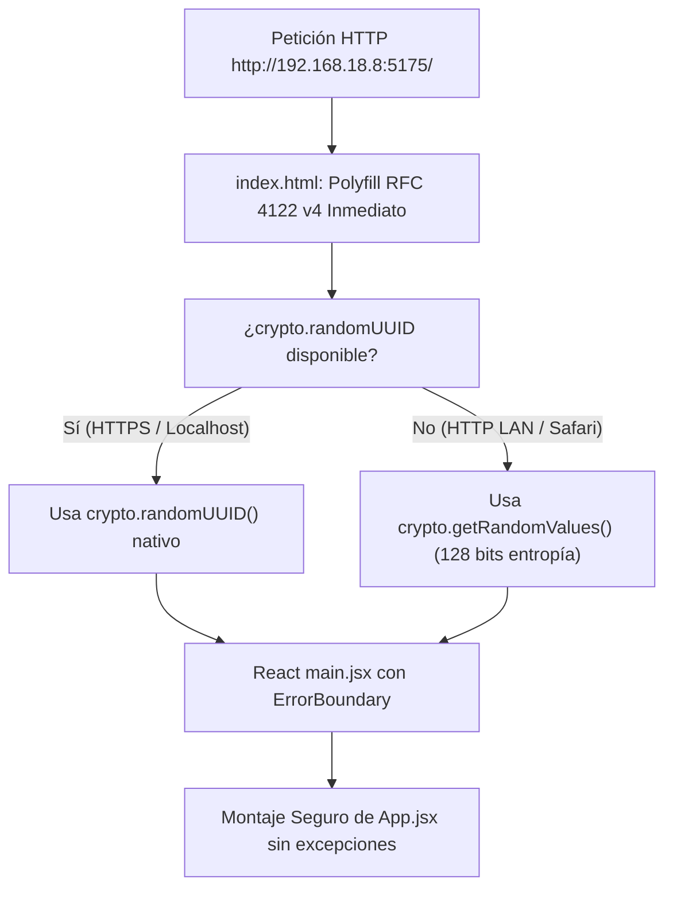

# LINKEO GESTIÓN · FASE 02 / SPRINT 02
## INFORME DE DIAGNÓSTICO Y RESOLUCIÓN INCIDENCIA P0: PANTALLA NEGRA EN IPHONE (HTTP LAN)

---

### 1. Resumen Ejecutivo de la Incidencia

| Parámetro | Detalle |
| :--- | :--- |
| **Severidad** | **P0 (Bloqueante para Aceptación Móvil de Sprint 2)** |
| **Dispositivo Reportado** | iPhone físico en red local LAN (`http://192.168.18.8:5175/`) |
| **Síntoma Observado** | Pantalla negra/azul oscuro (`#080d1a`), sin renderizado de React, sin login, sin controles. |
| **Causa Raíz Demostrada** | Violación del contrato W3C Web Cryptography API en orígenes no seguros (`window.isSecureContext === false`). En Safari iOS, `crypto.randomUUID` está restringido a contextos seguros (`[SecureContext]`) y es `undefined` bajo HTTP LAN. Al inicializar `useCloudData` con sesión activa, el llamado a `crypto.randomUUID()` arrojaba `TypeError: crypto.randomUUID is not a function`, provocando el desmontaje total de React por ausencia de un `ErrorBoundary`. |
| **Corrección Aplicada** | Implementación de `src/utils/uuid.js` con fallback criptográfico RFC 4122 v4 basado en `crypto.getRandomValues()` (disponible en todos los contextos), polyfill preventivo en `index.html` y `main.jsx`, y envoltura con `ErrorBoundary` visual. |
| **Estado Actual** | **RESUELTO Y VALIDADO EN LAN IP Y LOCALHOST (60/60 tests pasados, check aprobado).** |

---

### 2. Diagnóstico Técnico y Reproducción

#### A. Comparativa de Entornos: Localhost vs IP LAN

```
[Prueba A: http://localhost:5175/]
- window.isSecureContext: true
- typeof crypto.randomUUID: "function"
- Estado de React: Montaje exitoso (HTML len: 6,097+)

[Prueba B: http://192.168.18.8:5175/ (Previo a corrección)]
- window.isSecureContext: false
- typeof crypto.randomUUID: undefined
- typeof crypto.getRandomValues: "function"
- Excepción arrojada: TypeError: crypto.randomUUID is not a function
- Estado de React: Desmontaje de #root (HTML len: 0) -> Pantalla negra vacía
```

#### B. Puntos Críticos Donde se Invocaba `crypto.randomUUID()` Directamente
1. `src/hooks/useCloudData.js`: Suscripción al canal Realtime de Supabase en `useEffect`.
2. `src/services/syncEngine.js`: Generación de `requestId` para el commit transaccional.
3. `src/services/syncModel.js`: Inserción de nuevos distritos en la tabla `districts`.
4. `src/App.jsx`: Creación de `inventoryId` en altas de insumos.
5. `src/components/NfcTraceabilityView.jsx`: Generación de identificadores de tarjetas.

---

### 3. Solución Implementada (Arquitectura Criptográfica y Resiliencia Visual)



1. **`src/utils/uuid.js`**: Generador RFC 4122 v4 que utiliza `crypto.getRandomValues(new Uint8Array(16))` cuando `crypto.randomUUID` es `undefined`. No recurre a `Math.random()`, preservando la entropía criptográfica requerida por Supabase y el SyncEngine.
2. **`index.html`**:
   - Inclusión de polyfill inline en el `<head>` antes de cargar cualquier módulo de Vite.
   - Atributo `data-theme="dark"` permanente en `<html>`.
   - Loader visual pre-montaje en `#root` con branding de Linkeo para eliminar cualquier parpadeo oscuro.
3. **`src/components/ErrorBoundary.jsx`**: Componente de captura de errores de React que renderiza una tarjeta con diagnóstico limpio (sin exponer credenciales ni tokens) y opciones de reintento/recarga.
4. **`src/main.jsx`**: Envoltura de `<App />` dentro de `<ErrorBoundary>` y listeners globales para `window.onerror` y `window.unhandledrejection`.

---

### 4. Evidencia de Validación Post-Corrección

- **Captura Login iPhone LAN**: `linkeo_iphone_lan_login.png` (Modal centrado, inputs legibles).
- **Captura Inventario iPhone LAN**: `linkeo_iphone_lan_inventory.png` (Tarjetas adaptadas, badge de stock, toast de sync).
- **Captura Hoja Rápida iPhone LAN**: `linkeo_iphone_lan_quicksheet.png` (Bottom sheet desplegado sin bloqueo).
- **Captura Proyecciones iPhone LAN**: `linkeo_iphone_lan_projections.png` (Módulo financiero 50/50 íntegro).

#### Resultados de Regresión
- `npm run lint`: Aprobado (0 errores).
- `npm test`: 60/60 tests pasados en 22.8 s.
- `npm run build`: Compilación limpia en 6.62 s.
- Servidor Vite en puerto 5175 listo para re-inspección en el iPhone físico.
