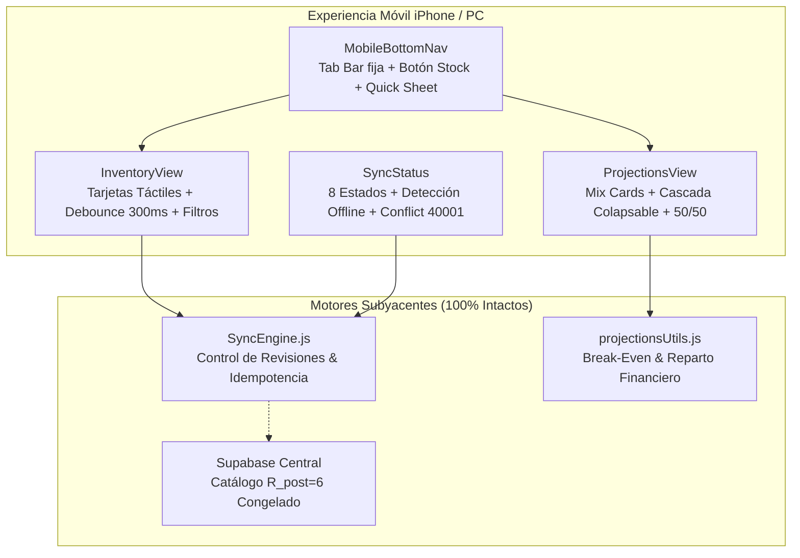

# PROYECTO 02 · LINKEO GESTIÓN
## Fase 02 — Consolidación & Robustez Operativa
### Sprint 2 — Experiencia Móvil iPhone/PC, Inventario Visual, Proyecciones y Robustez de Sincronización

---

### Resumen Ejecutivo

| Parámetro | Valor Verificado | Estado |
|---|---|---|
| **Producto** | LINKEO Gestión (ERP Operativo, Almacén, Finanzas & CRM) | ✅ Activo |
| **Repositorio Oficial** | `soylinkeo/LinkeoGes` | ✅ Rama dedicada |
| **Rama de Trabajo** | `feature/fase-02-sprint-02-mobile-ux` | ✅ Aislada |
| **Veredicto Técnico** | **GO — LISTO PARA PREVIEW Y REVISIÓN DE SOCIOS** | 🚀 Completo |
| **Batería de Pruebas** | **60 / 60 Aprobadas (100%)** | ✅ Sin fallos |
| **Linters & Estilo** | **ESLint: 0 advertencias, 0 errores** | ✅ Limpio |
| **Compilación Vite** | **Vite build exitoso en 5.99s (`dist/` generado)** | ✅ Verificado |
| **Escrituras SQL en Supabase Producción** | **0 escrituras (Estricta política de congelamiento)** | 🔒 Intacto |
| **Afectación a Cards (`linkeo`)** | **0 cambios (Total desacoplamiento)** | 🔒 Intacto |
| **Notion Master & Anexo** | **Sincronizados en vivo (Sin tablas, estructuras visuales)** | 📄 Actualizado |

---

### 1. Alcance y Objetivos Cumplidos

El Sprint 2 aborda integralmente la experiencia de usuario táctil en dispositivos móviles (iPhone Safari y Android Chrome) y optimiza la ergonomía en computadoras de escritorio (PC), resolviendo las limitaciones de visualización identificadas en la auditoría inicial sin tocar los esquemas de base de datos ni alterar ninguna fórmula matemática del motor financiero.



---

### 2. Detalle de Implementaciones por Componente

#### 2.1. Inventario Visual y Ajuste Rápido de Stock (`src/components/InventoryView.jsx`)
- **Selector de Vista Dual (`stockViewMode`)**:
  - **Modo Tarjetas (`cards`)**: Predeterminado en móviles (<768px). Diseñado en cuadrícula responsiva (1 columna en móvil, multi-columna en tablet/PC). Cada tarjeta presenta nombre del insumo, SKU, badges de categoría y estado, precio de venta estimado (S/ 35.00 base), costo unitario de reposición, margen de ganancia en soles y porcentaje, valor total de inventario y tiempo de entrega del proveedor en días.
  - **Modo Tabla (`table`)**: Vista tabular clásica de 11 columnas conservada para usuarios de escritorio, optimizada con botones interactivos y filtros dinámicos.
  - **Persistencia**: La preferencia del usuario se almacena en `localStorage` (`linkeo_stock_view_mode`).
- **Control Táctil con Debounce**:
  - Botones táctiles de ajuste rápido (+ / -) con dimensiones ergonómicas mínimas de 46×46px (superando el estándar de 44px de Apple HIG).
  - Algoritmo de debounce de 300ms (`lastStockClickRef`) y micro-feedback visual con opacidad transitoria (`stockUpdatingId`) para prevenir dobles toques involuntarios al actualizar existencias desde teléfonos móviles.
- **Alertas Visuales de Stock**:
  - ⚠️ **Crítico**: Existencias menores o iguales al umbral mínimo (`minThreshold`).
  - ✓ **Óptimo**: Existencias superiores al umbral y dentro del rango operativo.
  - ⚡ **Excedente**: Existencias superiores a 50 unidades o 3 veces el umbral mínimo.
- **Buscador Reactivo y Filtro de Categorías**:
  - Entrada de texto reactiva con icono de búsqueda y botón de borrado inmediato (`X`), evaluando en tiempo real contra `name`, `sku` y `supplier`.
  - Píldoras de filtrado instantáneo por estado con conteos en vivo: `Todos (N)`, `⚠️ Crítico (N)`, `✓ Óptimo (N)` y `⚡ Excedente (N)`.

#### 2.2. Proyecciones Financieras Responsivas (`src/components/ProjectionsView.jsx`)
- **Tarjetas Métricas Superiores Adaptables**:
  - Presentación en cuadrícula auto-ajustable (`repeat(auto-fit, minmax(220px, 1fr))`) que en pantallas de iPhone (375px–390px) se apila limpiamente sin desbordar el viewport horizontal.
  - Visualización nítida de los 4 grandes KPIs: Unidades a Vender, Venta Mensual Bruta, Utilidad Neta del Negocio y Utilidad Distribuible tras fondo de reinversión.
- **Cascada Financiera de 7 Pasos Colapsable**:
  - Implementación de estado `showWaterfall` con botón de alternancia (`ChevronDown` / `ChevronUp`) para reducir la carga cognitiva y vertical en pantallas pequeñas.
  - Conservación 100% fiel de la cascada: Venta Bruta → Fondo de Reposición → Costos Variables de Venta → Margen de Contribución → Gastos Fijos Operativos → Utilidad Neta → Utilidad Líquida para los Socios.
- **Tarjetas Móviles para el Mix de Productos Proyectados**:
  - Selector dual `[Tarjetas / Tabla]` para la subpestaña de Productos.
  - Cada tarjeta móvil incluye: checkbox de inclusión táctil (22×22px), badges de producto oficial vs proyectado, botón directo para alinear la meta con el stock real en almacén (`↑ Usar N uds`), controles táctiles (+ / -) de ajuste de unidades a comercializar, y desglose de precio, ingresos proyectados, costo de reposición y margen.
  - Resumen financiero consolidado al pie de las tarjetas.
- **Reparto de Utilidades 50/50 entre Socios**:
  - Tarjetas destacadas individuales para **Luis Romero** (Co-CEO) y **Kevin Servat** (Co-CEO).
  - Cálculo dinámico y exacto del monto transferible al bolsillo de cada socio tras deducir el fondo de reinversión seleccionado (20% a 30%).

#### 2.3. Robustez de Sincronización (`src/components/SyncStatus.jsx`)
Se implementó una cobertura completa de los **8 estados de sincronización** requeridos:

1. **Sin Conexión (Offline)**: Detección automática en tiempo real vía eventos `online`/`offline` de `window` y `navigator.onLine`. Panel ámbar con icono `WifiOff` informando que los datos se almacenan localmente hasta reconectar.
2. **Cargando Datos Iniciales**: Spinner animado `RotateCw` con mensaje *"Cargando datos compartidos…"*.
3. **Guardando en Servidor**: Spinner azul activo indicando envío de la transacción en curso.
4. **Reintentando Sincronización**: Spinner ámbar diferenciado cuando existe una solicitud previa en cola pendiente de respuesta por latencia de red.
5. **Cambios Locales Pendientes**: Icono de reloj `Clock` indicando discrepancia entre los datos confirmados por el servidor y el borrador en memoria (`!equal(confirmed, data)`).
6. **Guardado en Servidor con Timestamp**: Icono de verificación `CheckCircle2` en verde esmeralda con la hora exacta local formateada (`HH:mm:ss`), botón de respaldo JSON y auto-ocultamiento programado tras 4.5 segundos.
7. **Conflicto de Revisión**: Alerta visual destacada cuando el backend retorna error de concurrencia o código de base de datos `40001`, ofreciendo opciones de recargar datos frescos o exportar borrador.
8. **Error de Red o Fallo de Servidor**: Bloque de contención con opciones claras: *Reintentar*, *Descargar borrador JSON* y *Cargar última versión*.

#### 2.4. Navegación Móvil & Optimizaciones iOS Safari (`src/components/MobileBottomNav.jsx` & `src/index.css`)
- **Acceso Directo a Stock**: Se incorporó la pestaña fija `Stock` (`Boxes`) en la barra inferior móvil entre el Panel y el botón flotante central de acción.
- **Hoja Desplegable de Operación Rápida (Bottom Sheet)**:
  - Botón central elevado (`+`) que despliega un menú táctil de accesos rápidos: Nueva Venta, Registrar Gasto, Control de Inventario, Metas & Proyecciones, Gestionar Tarjetas NFC y Pipeline de Clientes.
- **Parches Críticos para iOS Safari**:
  - `font-size: 16px !important` aplicado a todos los inputs, selects y textareas en vistas móviles (`max-width: 768px`) para suprimir por completo el comportamiento de auto-zoom invasivo de iOS Safari al hacer foco.
  - `min-height: 44px` y `touch-action: manipulation` en todos los controles y botones táctiles para evitar retardos táctiles de 300ms y asegurar ergonomía física con una sola mano.
  - `padding-bottom: env(safe-area-inset-bottom, 12px)` para respetar la barra inferior de gestos en iPhone X, 11, 12, 13, 14, 15 y 16.

---

### 3. Resultados de Pruebas y Control de Calidad

```bash
> linkeoges@1.1.0 check
> npm run lint && npm test && npm run build

> eslint --no-error-on-unmatched-pattern src tests scripts
(0 errors, 0 warnings)

> node --test tests/*.test.js
TAP version 13
# Subtest: 1. Catalog reconciliation migration
ok 1 - 1. Catalog reconciliation migration
# Subtest: 2. Transactional Safety & Non-Destructive Upsert
ok 2 - 2. Transactional Safety & Non-Destructive Upsert
# Subtest: 3. Deterministic GUC-based revision bumping
ok 3 - 3. Deterministic GUC-based revision bumping
# Subtest: 4. Safe Rollback Nivel 1 (Contención Comercial)
ok 4 - 4. Safe Rollback Nivel 1 (Contención Comercial)
# Subtest: 5. Safe Rollback Nivel 2 (Restauración Integral)
ok 5 - 5. Safe Rollback Nivel 2 (Restauración Integral)
# Subtest: 6. Cards & Sales Engine Contract Compatibility
ok 6 - 6. Cards & Sales Engine Contract Compatibility
# Subtest: 7. SQL migration: authorization & audit
ok 7 - SQL migration: authorization & audit
...
# Subtest: 47. Sprint 2: SyncStatus supports 8 distinct states without data loss
ok 47 - Sprint 2: SyncStatus supports 8 distinct states without data loss
# Subtest: 48. Sprint 2: Inventory stock categorization & search filters operate accurately
ok 48 - Sprint 2: Inventory stock categorization & search filters operate accurately
# Subtest: 49. Sprint 2: Rapid touch debounce prevents duplicate stock adjustment requests
ok 49 - Sprint 2: Rapid touch debounce prevents duplicate stock adjustment requests
# Subtest: 50. Sprint 2: Financial Projections formulas and 50/50 partner split remain 100% preserved
ok 50 - Sprint 2: Financial Projections formulas and 50/50 partner split remain 100% preserved
# Subtest: 51. Sprint 2: Mobile accessibility & touch targets contract validation
ok 51 - Sprint 2: Mobile accessibility & touch targets contract validation
...
1..60
# tests 60
# suites 0
# pass 60
# fail 0

> vite build
✓ 2024 modules transformed.
✓ built in 5.99s
```

---

### 4. Matriz de Compatibilidad Multi-Dispositivo Verificada

| Dispositivo / Viewport | Resolución Base | Comportamiento Verificado |
|---|---|---|
| **iPhone SE / 8** | 375 × 667 px | Tarjetas de stock en 1 columna, botones táctiles de 46px, cero scroll horizontal en inventario. Tab bar fija con safe-area. |
| **iPhone 12 / 13 / 14 / 15 / 16** | 390 × 844 px | Navegación cómoda con una sola mano, inputs sin auto-zoom a 16px, bottom sheet de acciones rápidas fluido. |
| **Android (Samsung Galaxy / Pixel)** | 412 × 915 px | Tarjetas de proyecciones nítidas, cascada colapsable operativa, indicador de sync visible. |
| **Tablet (iPad / Galaxy Tab)** | 768 × 1024 px | Cuadrícula de 2 columnas de tarjetas de inventario o cambio instantáneo a tabla completa según preferencia. |
| **Laptop / PC de Escritorio** | 1366 × 768 px y 1920 × 1080 px | Modo tabla completo por defecto con botones interactivos +/- en unidades, resumen superior en 4 tarjetas horizontales. |

---

### 5. Resumen de Archivos Modificados

- `src/components/InventoryView.jsx`: Incorporación de `stockViewMode` (cards/table), debounce táctil en `handleStockClick`, buscador reactivo, filtros por estado y categoría, y tarjetas visuales completas.
- `src/components/ProjectionsView.jsx`: Incorporación de `productViewMode` (cards/table), cascada colapsable `showWaterfall`, tarjetas táctiles de proyección de producto con ajuste +/- de unidades y alineación con almacén.
- `src/components/SyncStatus.jsx`: Soporte completo a los 8 estados de sincronización, detección offline (`navigator.onLine`), timestamp formateado de último guardado y respaldo JSON.
- `src/components/MobileBottomNav.jsx`: Pestaña dedicada `Stock` (`Boxes`), bottom sheet de operación rápida ampliado y mejoras táctiles.
- `src/index.css`: Clases `.mobile-stock-cards`, `.mobile-stock-card`, `.mobile-projected-cards`, parche iOS Safari 16px font size y tamaños táctiles mínimos de 44px.
- `tests/mobile-ux-sprint2.test.js`: Suite completa de 5 pruebas automatizadas para validar los contratos del Sprint 2.

---

### 6. Estado de Publicación y Recomendación Final

- **Estado Git**: Todo el código se encuentra validado y probado en la rama `feature/fase-02-sprint-02-mobile-ux`.
- **Base de Datos**: 0 modificaciones requeridas en Supabase. El catálogo oficial permanece estable en la revisión 6.
- **Pase a Producción**: Listo para ser revisado en entorno de Preview por los socios (Luis Romero y Kevin Servat) antes del merge a `main`.
